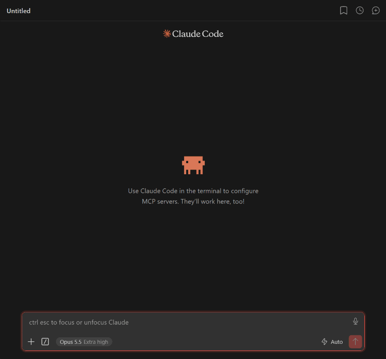
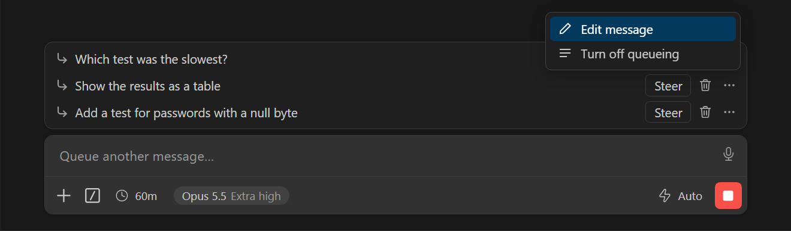
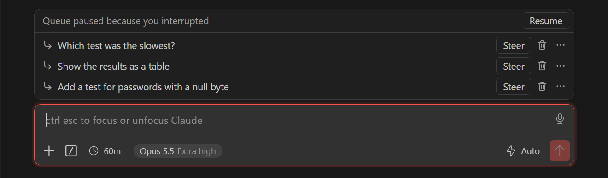

<div align="center">

# Claude Code Queue Mode

**Очередь сообщений для расширения Claude Code в Cursor и VS Code, как в Codex.**
Пиши, пока Claude работает: сообщения встают в очередь и уходят по одному.
А когда нужно, их можно отправить прямо в текущую задачу или прервать её.

[English](README.md) · [Установка](#установка) · [Как это работает](#как-это-работает) · [Клавиши](#клавиши) · [Вопросы](#вопросы)



</div>

## Зачем

В расширении Claude Code всё, что ты отправляешь, пока Claude работает, вклинивается в текущую задачу. Иногда это то, что нужно. Но часто хочется просто поставить следующую задачу в очередь и не сбивать текущую.

В Codex для этого есть **очередь сообщений**. Этот проект добавляет такую же очередь в Claude Code:

- 📝 **Очередь** — сообщения, отправленные во время работы, ждут над полем ввода и уходят по одному, каждое отдельной задачей.
- 🧭 **Steer** — сообщение сразу уходит в текущую задачу. Так Claude Code работает без патча.
- ⛔ **Interrupt** — текущая задача останавливается, и новое сообщение выполняется сразу.
- ⌨️ **Ctrl+Enter** — обратное действие для одного сообщения.
- ✏️ Сообщение в очереди можно отредактировать, перетащить, удалить или отправить сразу.
- ⏸️ Stop или Esc ставят очередь на паузу, кнопка **Resume** продолжает.
- 💾 Очередь хранится отдельно для каждого чата, вместе с картинками и выделенным кодом, и переживает перезагрузку окна.
- ⏳ Видно, что Claude работает, из любой программы: песочные часы в названии окна и полоса на кнопке в панели задач. Когда он закончил или ждёт ответа, приходит уведомление Windows.
- 🔄 Переживает обновления Claude Code: патч сам переносится на новые версии.

## Установка

Установщик находит Claude Code в **Cursor, VS Code, VS Code Insiders и Windsurf** (в том числе на их удалённых серверах) на **Windows, macOS и Linux**.
Node.js не обязателен: без него установщик использует движок самого редактора.

**Windows** — в PowerShell:

```powershell
irm https://raw.githubusercontent.com/n1ghtmare-dev/claude-code-queue-mode/main/install.ps1 | iex
```

Или [скачай архив](https://github.com/n1ghtmare-dev/claude-code-queue-mode/releases/latest/download/claude-code-queue-mode.zip), распакуй и запусти **`install.bat`**.

**macOS / Linux:**

```bash
curl -fsSL https://raw.githubusercontent.com/n1ghtmare-dev/claude-code-queue-mode/main/install.sh | bash
```

**Любая ОС с Node.js:**

```bash
npx -y github:n1ghtmare-dev/claude-code-queue-mode
```

После установки перезагрузи окно редактора: <kbd>Ctrl</kbd>+<kbd>Shift</kbd>+<kbd>P</kbd> → **Developer: Reload Window**.

> [!TIP]
> Ставить нужно один раз. Когда редактор обновит Claude Code, пропатченное расширение само перенесёт очередь на новую версию и покажет кнопку **Reload Window**. Если что-то пойдёт не так, просто запусти установщик ещё раз.

### Удаление

| | |
|---|---|
| Windows | `& ([scriptblock]::Create((irm https://raw.githubusercontent.com/n1ghtmare-dev/claude-code-queue-mode/main/install.ps1))) -Uninstall` или `uninstall.bat` |
| macOS / Linux | `curl -fsSL https://raw.githubusercontent.com/n1ghtmare-dev/claude-code-queue-mode/main/install.sh \| bash -s -- --unpatch` |
| Node.js | `npx -y github:n1ghtmare-dev/claude-code-queue-mode --unpatch` |

Исходные файлы восстанавливаются из резервных копий. После этого перезагрузи окно.

## Как это работает

Поведение по умолчанию выбирается в **Settings → Claude Code › Follow Up Queue Mode** (`claudeCode.followUpQueueMode`):

| Режим | Что происходит с сообщением, отправленным во время работы |
|---|---|
| `queue` *(по умолчанию)* | встаёт в список над полем ввода и уходит новой задачей, когда Claude закончит, по одному |
| `steer` | сразу уходит в текущую задачу, Claude подхватывает его между шагами (как в обычном Claude Code) |
| `interrupt` | останавливает текущую задачу (как кнопка Stop) и выполняется сразу |

Переключаться между queue и steer можно и из меню `⋯` у любого сообщения в очереди: **Turn off / on queueing**.



### Очередь

| Действие | Что делает |
|---|---|
| **Steer** | отправить сообщение сейчас: в текущую задачу, если Claude работает, иначе новой задачей |
| 🗑 | удалить сообщение |
| `⋯` → **Edit message** | вернуть сообщение в поле ввода; после повторной отправки оно встанет на прежнее место |
| перетаскивание | поменять порядок |
| **Stop / Esc** | очередь встаёт на паузу («Queue paused because you interrupted»), продолжить — **Resume** |
| отправка на паузе | вопрос: очистить очередь (**Clear queue**) или просто отправить (**Send message**) |



### Клавиши

| Сочетание | Пока Claude работает |
|---|---|
| <kbd>Enter</kbd> | действие режима по умолчанию (queue / steer / interrupt) |
| <kbd>Ctrl</kbd>/<kbd>Cmd</kbd>+<kbd>Enter</kbd> | обратное действие для одного сообщения: queue ↔ steer |
| <kbd>Enter</kbd> в пустом поле | в режиме steer сразу отправляет первое сообщение из очереди |

Если включено **Use Ctrl+Enter to send**, отправка — <kbd>Ctrl</kbd>+<kbd>Enter</kbd>, а обратное действие — <kbd>Ctrl</kbd>+<kbd>Shift</kbd>+<kbd>Enter</kbd>. Подсказка появляется при наведении на кнопку отправки.

## Как узнать, что Claude закончил

Следить за чатом не нужно. Можно уйти в другую программу или отойти от компьютера. Каждое окно редактора показывает своё состояние:

| | Что видно |
|---|---|
| Claude работает | `⏳` в заголовке окна (а значит, и на кнопке в панели задач) и перед названием вкладки чата. В Windows по кнопке ещё бежит зелёная полоса |
| Claude ждёт ответа | `✋` и жёлтая полоса, плюс уведомление |
| Claude закончил | `✓` в заголовке окна и оранжевая кнопка в панели задач, пока не вернёшься в окно, плюс уведомление; клик по нему возвращает в это окно |


| Настройка | |
|---|---|
| `claudeCode.workingIndicator` | `true` (по умолчанию) / `false`: значок `⏳` и полоса в панели задач |
| `claudeCode.notifyWhenDone` | `whenUnfocused` (по умолчанию): только если ты не смотришь в это окно · `always` · `off` |

Значок в заголовке окна — это переменная `${claudeActivity}`. Со стандартным заголовком она не нужна: в нём и так есть название вкладки чата. Если твой `window.title` не показывает активную вкладку, патч один раз добавит `${claudeActivity}` в его начало. Если убрать её из настройки, она не вернётся.

Полоса в панели задач и системные уведомления работают только в Windows. В macOS и Linux будет значок `⏳` и уведомление внутри редактора. Пока из очереди уходит следующее сообщение, уведомление не шлётся, поэтому очередь из пяти сообщений даст одно уведомление в конце.

## Вопросы

**Это расширение?**
Нет, это небольшой патч для уже установленного Claude Code. Установщик правит три файла в его папке (`~/.cursor/extensions/anthropic.claude-code-*` или аналог у VS Code), а оригиналы сохраняет рядом как `*.cq-orig`.

**Это безопасно?**
Патч трогает только локальные файлы, ничего не скачивает и ничего не собирает. Каждое изменение проверяется на синтаксические ошибки до записи. Если код Claude Code выглядит не так, как ожидается, установщик отказывается ставить патч и ничего не меняет. `--unpatch` возвращает оригиналы.

**Какие версии Claude Code поддерживаются?**
Разработано и проверено на Claude Code **2.1.301** в Cursor под Windows. Логика очереди не завязана на минифицированные имена, поэтому должна переживать большинство обновлений. Если обновление что-то сломает, установщик так и скажет — [создай issue](https://github.com/n1ghtmare-dev/claude-code-queue-mode/issues/new/choose).

**Очередь не появилась.**
Сначала перезагрузи окно. Потом проверь статус:

```bash
npx -y github:n1ghtmare-dev/claude-code-queue-mode --status
```

(или `install.bat --status`, `bash install.sh --status`).

**А слэш-команды?**
`/compact`, `/model` и другие слэш-команды в очередь не ставятся и работают как раньше.

**Отличия от Codex**
- В Codex режим `interrupt` работает как `steer`; здесь он действительно останавливает текущую задачу.
- Если отправить сообщение в режиме steer и потом нажать Stop, Claude Code всё равно выполнит его после остановки (так он работает и без патча). Codex вернул бы его в очередь.
- После перезагрузки окна восстановленная очередь стоит на паузе, чтобы ничего не ушло само.

## Лицензия

[MIT](LICENSE). Неофициальный проект, не связан с Anthropic и OpenAI.
